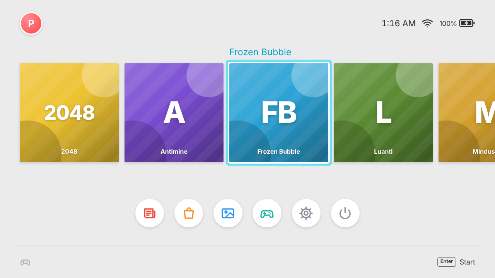
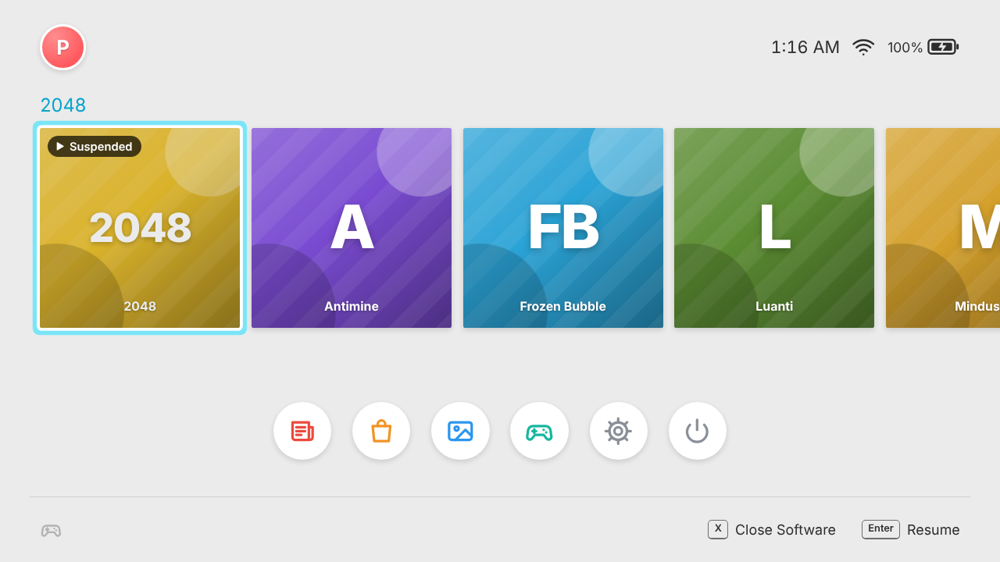
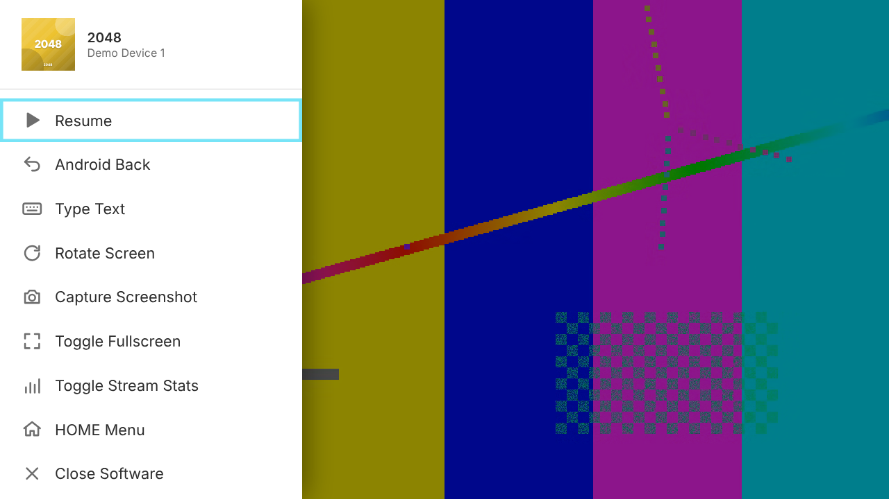
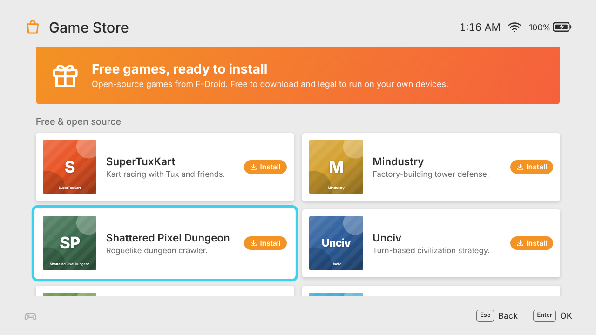
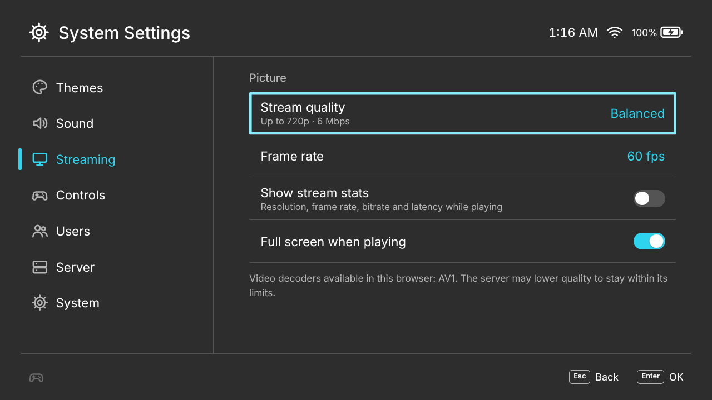

# Synapse

A cloud gaming service for Android games with a console-style home menu. Players pick a game from a tile row, it starts on an Android device in your pool, and the screen streams to their browser. Touch, keyboard and controllers are sent back to the device.



| | |
|---|---|
|  |  |
|  |  |

*Screenshots use the built-in demo device, which streams a test pattern instead of a game.*

## Where the Android devices come from

No hosted Android provider is both free and unlimited. Browser cloud phones and app players have play-time limits, queues, ads, or terms that forbid embedding or reselling them. So Synapse runs its own pool. Any device that `adb` can reach works:

| Source | Cost | Limit |
|---|---|---|
| **[redroid](https://github.com/remote-android/redroid-doc)** (Android in a Docker container) | Free, open source | Your hardware: about 2–3 GB RAM per device |
| A free cloud VM running redroid, e.g. an Oracle Cloud *Always Free* Arm instance (check their current terms) | Free | That VM's CPU and RAM |
| Old Android phones on your network (`adb tcpip 5555`) | Free | How many phones you have |
| Android emulators, Waydroid, Genymotion | Free / varies | Your hardware |

The included `docker-compose.yml` runs redroid, and `docker compose up --scale redroid=N` adds devices. Each device runs one game at a time. When every device is busy, players wait in a queue and start automatically when one frees up.

## Features

- **Console-style interface**: lock screen, HOME Menu tile row with the pulsing selection frame, a dock of round buttons, button hints that switch to keyboard labels, synthesised click sounds, and Basic White / Basic Black themes. It's an original design with no console maker's assets or trademarks.
- **Works with controllers, keyboard, mouse and touch**: spatial focus navigation with key repeat. On touch screens you tap once to select and again to start.
- **Suspend and resume**: HOME returns to the menu while the game keeps its device. Tap the tile to resume, or press X to close it.
- **Low-latency streaming**: [scrcpy](https://github.com/Genymobile/scrcpy) captures H.264 (H.265/AV1 optional) and Opus audio on the device. The server relays the packets over a WebSocket, and the browser decodes them with WebCodecs.
- **Multi-user pool**: a queue with live position, idle timeout, optional session cap, and app reset between players.
- **Game Store**: one-click installs of free, open-source games from F-Droid, plus APK upload, renaming, cover art and hiding. Installed APKs are kept, so new or reset devices are filled in automatically.
- **Users and Album**: per-browser profiles with play activity, plus screenshots (F8) saved to the Album.
- **Network Status**: live device states, queue length and latency.

## Quick start: try it without Android

Needs Node.js 20+ and ffmpeg with libx264 (the demo devices stream an ffmpeg test pattern).

```sh
npm install
npm run dev            # starts two demo devices
open http://localhost:8080
```

Press any key three times to unlock, then start any tile.

## Deploy with redroid

1. **Host kernel.** redroid needs binder. On Ubuntu:

   ```sh
   sudo apt install linux-modules-extra-$(uname -r)
   sudo modprobe binder_linux devices="binder,hwbinder,vndbinder"
   echo 'binder_linux' | sudo tee /etc/modules-load.d/redroid.conf
   echo 'options binder_linux devices="binder,hwbinder,vndbinder"' | sudo tee /etc/modprobe.d/redroid.conf
   ```

   See the [redroid docs](https://github.com/remote-android/redroid-doc) for other distributions.

2. **Start it.**

   ```sh
   export ADMIN_TOKEN=$(openssl rand -hex 16); echo "$ADMIN_TOKEN"
   docker compose up -d --build
   docker compose up -d --scale redroid=4     # optional: more devices
   ```

3. **Serve it over HTTPS.** Browsers only allow WebCodecs on secure pages (HTTPS or `localhost`). For example, with [Caddy](https://caddyserver.com):

   ```
   games.example.com {
       reverse_proxy localhost:8080
   }
   ```

4. **Add games.** Open the site, go to **System Settings › Server › Admin token** and paste the token. Then use **Game Store** to install free games or upload APKs. Only upload games you have the right to use.

**Never expose port 5555.** ADB gives full control of a device. Compose keeps it on the internal network.

### Architecture notes

- **Arm vs x86:** most Android games ship Arm code. On an Arm64 host (for example Ampere or Graviton) they run natively. On x86 hosts, many games need a redroid image with Arm translation (libndk/libhoudini).
- **No GPU:** redroid falls back to software rendering, which is fine for 2D games but slow for heavy 3D.
- **Audio:** needs Android 11+ on the device. If a device can't capture audio, the stream continues without it.

### Running without Docker

Install `adb` and run `npm run fetch-scrcpy`. Then:

```sh
ANDROID_DEVICES=192.168.1.20:5555,emulator-5554 ADMIN_TOKEN=... npm start
```

## Configuration

| Variable | Default | |
|---|---|---|
| `ANDROID_DEVICES` | – | Comma-separated ADB serials. `dns:host:port` adds every address `host` resolves to |
| `DEMO_DEVICES` | `1` if no devices, else `0` | Number of test-pattern devices |
| `ADMIN_TOKEN` | – | Enables installing and managing games from the UI |
| `ACCESS_CODE` | – | Code players must enter to play |
| `IDLE_TIMEOUT` | `600` | Seconds without input before a session ends (`0` = never) |
| `SESSION_MAX_MINUTES` | `0` | Hard session limit (`0` = unlimited) |
| `RESET_MODE` | `stop` | After a session: `stop` force-stops the game, `clear` also wipes its data |
| `ALLOW_SYSTEM_KEYS` | `false` | Let players send Android HOME / RECENTS |
| `VIDEO_CODECS` | `h264` | Codecs devices may encode, in order of preference (`h264,h265,av1`) |
| `AUDIO` | `true` | Stream game audio |
| `KEYFRAME_INTERVAL` | `2` | Seconds between keyframes (faster recovery after dropped frames) |
| `MAX_SIZE_LIMIT` / `MAX_BITRATE_LIMIT` / `MAX_FPS_LIMIT` | `1920` / `16000000` / `60` | Caps on what players can request |
| `SCRCPY_VERSION` / `SCRCPY_SERVER_PATH` | `3.3.1` / `vendor/scrcpy-server` | Must match each other |
| `PORT` / `DATA_DIR` | `8080` / `./data` | |

`config/games.json` can pin titles, publishers, colours and cover URLs for packages. Set `"autoDiscover": false` to show only the games listed there.

## Controls while playing

| | Keyboard / mouse | Controller | Touch |
|---|---|---|---|
| HOME Menu (suspend) | Esc | HOME, or Select + Start | ⌂ button |
| Quick menu | F2 | Hold HOME | ⋯ button |
| Screenshot | F8 | Quick menu | Quick menu |
| Android Back | Right click | B (in many games) | Quick menu |
| Game input | Mouse = touch, keys pass through | Buttons as Android gamepad keys, left stick as D-pad | Multi-touch |

Analog sticks can't travel as Android key events, so the left stick works as a D-pad.

## How it works

```
browser ──HTTPS/WSS──▶ server (Node) ──adb──▶ device
  ▲  WebCodecs decode     │ device pool + queue     scrcpy-server (pushed per session)
  │  canvas + Web Audio   │ validates every input   encodes screen (H.264) and audio (Opus)
  └──── video/audio packets ◀── forwarded as-is ◀── over an adb forward tunnel
```

- `server/scrcpy.js` and `server/protocol.js`: the scrcpy 3.x socket handshake, media framing and control messages.
- `server/devices.js`: health checks, DNS discovery, queueing and auto-install.
- `server/session.js`: one WebSocket play session. It applies backpressure by dropping to the next keyframe, plus the idle and time limits.
- `public/js`: the interface, with no build step. `core/nav.js` handles spatial navigation, `core/input.js` unifies input, and `stream/` decodes the stream.

## Tests

```sh
npm test
```

The tests cover the scrcpy protocol, the H.264/AV1 parsers and codec strings, and the full server with demo devices (including the two-player queue). They also run the ADB path end to end against `test/fixtures/fake-adb.mjs`, which simulates devices and a scrcpy server speaking the real protocol.
